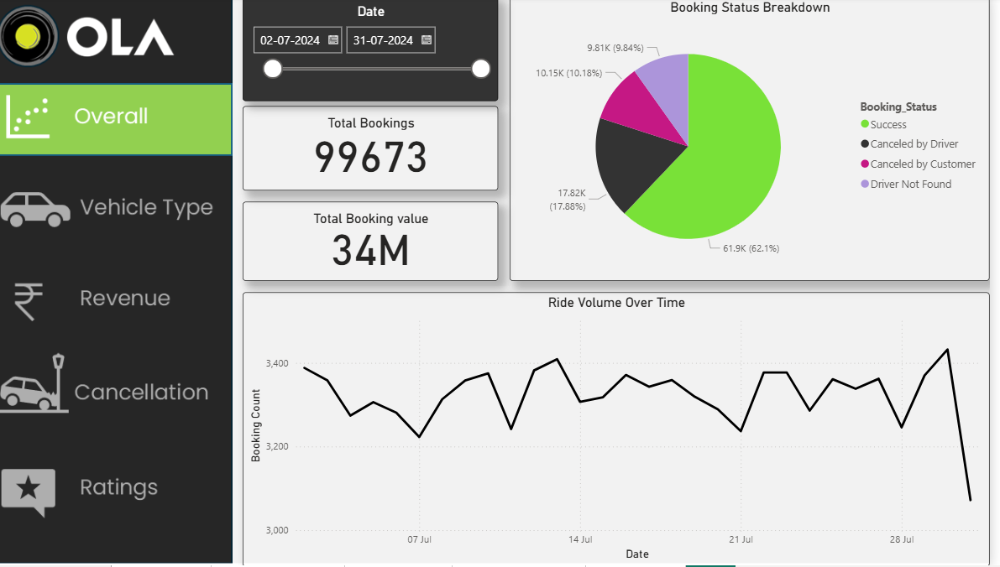
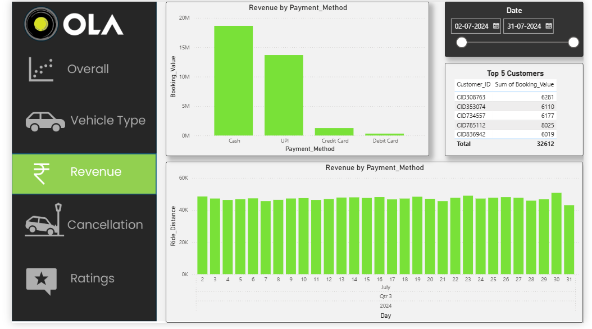

# Ola-ride-cancellation-analysis
Analysis of Ola ride cancellations using SQL and Power BI.

## About
Short description of what the project analyses and why.

## Tools Used
SQL, Power BI, Excel

## Process
Cleaned and processed the data from multiple sources, applied SQL queries,
and visualised the trends using Power BI.

## Key Findings
- Finding 1 (from your data)
- Finding 2

## Dashboard Preview

### 1. Overview

### 2. Cancellation Rate

### 3. Vehicle Booking

### 4. Revenue

### 5. Vehicle Ratings

